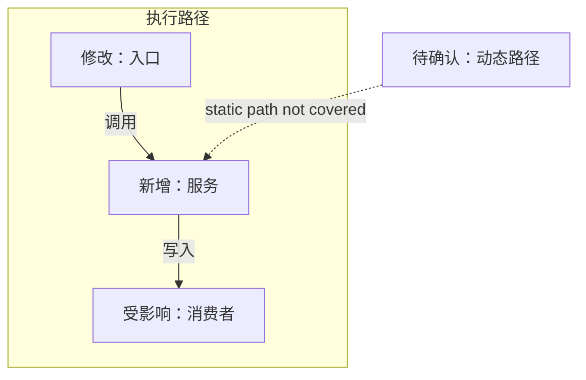

# pr-open — 准备并创建 Pull Request

> **适用**：用户要求开 PR；或 `full-stop` / `full-send` 串联到 PR 生命周期。**主导工具**：一个独立 reviewer + `gh`。

## 步骤

1. **准备上下文。** 当前任务链尚未加载或会话恢复时读取 `references/change-impact.md` 和 `references/pr-review-policy.md`；否则复用。查看目标分支、merge-base、head、未提交改动和该分支是否已有 PR；保持用户已有工作。Full mode 若当前在默认分支，为本任务创建 topic branch，不推默认分支。只接续 head 与当前任务分支匹配的已有 PR；分支不匹配就停止，不修改该 PR。Full-stop 授权仅对这条任务 PR 关闭 auto-merge / 退出 merge queue；改动前和每次 push 前核实已关闭，不能确认时暂停。
2. **核对范围与风险。** 一个 PR 聚焦一个逻辑变更。按实际 diff 和受影响模块给出 Low / Medium / High 风险与理由；作者身份不降低风险。只有摘要、没有 diff 时，风险和可逆性标为 `未评估`，说明缺少哪些证据，不从模块名称或主题猜测等级。按仓库惯例取标题范例，标题简洁说明问题或收益。描述先说问题和解决方式，再给影响图、风险和验证；不列文件清单复述 diff。
3. **生成 Change map。** 比较 base/head 的代码依赖图，在 PR 正文中用 Mermaid 表达新增、修改、删除、受影响模块、关系变化和分析限制；对照 diff 核验节点与关系。图按 `references/change-impact.md` 使用短标签、分组和可读布局，不生成 SVG 或 JSON 附件。
4. **写 PR 描述。** 按 `engineering-writing` 起草，再按 `unslop` 检查。把 Mermaid 代码块直接放在正文；只准备草稿时交付完整 Markdown 正文。
5. **独立审查。** 只有准备提交/更新真实 PR，或用户明确要求独立审查时，才启动一次 Spec / Standards 审查；同时读取 Issue / 验收条件、base 到 head 的 diff、验证结果和 Change map。若用户只要本地 PR 草稿且没有代码改动或远端写入，不为草稿另派 reviewer/subagent，完成证据与格式自查并标出未解决项即可。High 风险的真实 PR 再增加一次聚焦安全、数据、并发或恢复路径的独立审查；使用 `references/pr-review-policy.md` 的人类审批门。没有 Spec 时注明并继续 Standards，不要运行缺失的 setup 命令。只修 blocker 与 should-fix。若真实 PR 流程没有可用 reviewer，自己做一轮相同检查并说明未独立复核。显式 PR review 请求继续使用 `pr-review.md` 的双轴审查。
6. **创建并核验。** 创建前把 Evidence 对齐到当前 head 和最近一次真实命令/日志；较早失败若后来已解决，更新为最新结果，未复跑则标为未复验。普通“开 PR”请求可在披露外部阻塞后创建 PR，但不可称 ready 或任务完全收尾；用户要求 full-stop/full-send 时继续按 `pr-babysit.md` 等到 ready 或明确阻塞。读取 GitHub checks/status，区分失败、进行中和无运行记录。用 `gh pr view` 核实标题、正文、Mermaid 代码块、最新 SHA 和状态；在 GitHub 预览中确认图已渲染且易读。图缺失、过期或渲染失败时修好再交付；无法预览时说明未验证。交付前清点本任务创建的临时文件、日志、验证目录和工作树，逐项标为已清理、为审查保留（写位置与用途）或未确认；仅清理由本任务创建且确认无用的产物，不能用干净的 `git status` 代替清理核查。

**轮次预算**：普通 PR 一轮初始 review，最多两轮有实质问题的 fix → push → recheck；`pr-babysit` 与本步骤共用该预算。安全、认证、数据丢失或并发风险仍有 blocker / should-fix 时最多五轮。后续轮次只复查行为改动和未解决 findings；纯文档、正文、附件或格式变化不重跑代码测试，也不触发新一轮 review。达到上限就交付当前已验证状态和阻塞项；未通过的必需门必须标为阻塞，不能把“已创建 PR”当成“问题已解决”。

## 仅更新现有 PR 正文

用户只要求修改已有 PR 的描述、Evidence 或 Change map，且不改代码时，走本 playbook 的精简路径：读取最新 PR body、base/head 和 diff，核实要修改的事实，只更新相关段落并保留仍准确的内容；替换或更新 Mermaid 图后在 GitHub 预览中检查渲染。用户授权远端更新后再保存正文，随后读取已保存正文确认它仍对应最新 head。此路径不创建分支或 PR、不提交代码、不做代码 review，也不运行无关代码测试；有 CI / review 事项时再移交 `pr-babysit.md`。交付前处置本次预览生成的临时文件，未知归属的文件不删除。

High 风险达到第三轮仍无收敛时，先重新评估设计和根因；只有后续轮次能验证实质修复时才可用到五轮。不得重复提交已核实且无新证据的 finding。

## 描述最小格式

````markdown
<问题与解决方式，1–2 句>

### Change map
Base: `<sha>` · Head: `<sha>` · Coverage: <证据范围与限制>

Unknowns: <未覆盖的关系或行为>

### Evidence
`<实际命令>` → <观察到的结果；行为变化时补充前后差异>

### Risk and recovery
Tier: <Low | Medium | High | 未评估> · Reason: <依据 diff 的一句话；无法评估时说明缺少的证据>
Reversibility: <easy to reverse | hard to reverse | 未评估> · Blast radius: <受影响模块或用户；无法评估时说明未知范围>
Rollback: <feature flag, revert, or recovery steps; state when reverting this PR is sufficient>
````

普通 PR 创建沿用 Mermaid 图和简短正文，不为内部 pre-open 审查另写 Postplan。用户要求独立报告或任务符合 `references/postplan-reports.md` 的报告型场景时，再生成 Postplan。

## 移交

用户明确要求继续看 CI 或评论 → `pr-babysit.md`。
