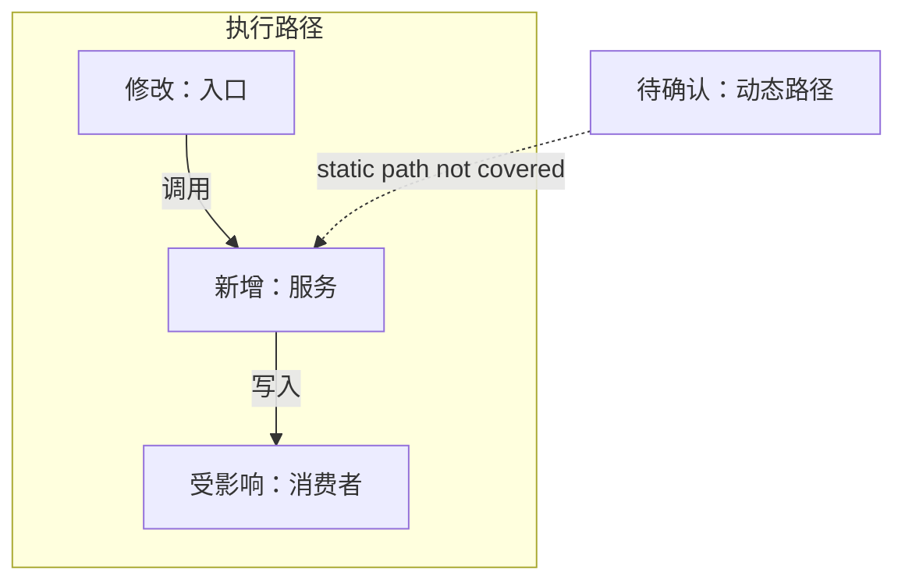

# pr-open: 准备并创建 Pull Request

> **适用**：用户要求开 PR；或 `full-stop` / `full-send` 串联到 PR 生命周期。**主导工具**：一个独立 reviewer + `gh`。

## 步骤

1. **准备上下文。** 当前任务链尚未加载或会话恢复时读取 `references/change-impact.md` 和 `references/pr-review-policy.md`；否则复用。查看目标分支、merge-base、head、未提交改动和该分支是否已有 PR；保持用户已有工作。Full mode 若当前在默认分支，为本任务创建 topic branch，不推默认分支。只接续 head 与当前任务分支匹配的已有 PR；分支不匹配就停止，不修改该 PR。Full-stop 授权仅对这条任务 PR 关闭 auto-merge / 退出 merge queue；改动前和每次 push 前核实已关闭，不能确认时暂停。Full-send 接手已有 PR 时按 `pr-babysit.md` 步骤 1 检查 queue / auto-merge：Agent 额外核验的条件满足、且所有未完成 gate 都有已核实的仓库规则保护时，才可保留并等待；否则先清除排队/自动合并再等待或写入。
2. **审查功能 diff 中的局部清理项。** 对功能 PR，仅审查本次功能 diff、直接调用点及关联配置。排查死代码、重复实现、无意义包装、无效防御分支、废弃注释和调试输出。仅当候选项涉及动态调用、插件注册或运行时配置时追踪其调用链，严禁扩大为全仓审计。仅自动处理高置信度、低风险的局部问题，并遵循 `SKILL.md` 的删除边界。保留公开契约、数据迁移、兼容路径及可能被动态加载的代码。若 PR 的目标是代码库清理，按 `code-cleanup.md` 对请求范围执行审计。
3. **复验清理结果。** 每次局部清理后运行覆盖受影响行为的相关检查。创建 PR 前核实相关测试全部通过，并将命令与实际输出记录至 Evidence。若清理会改变对外行为或扩大范围，撤回该清理，或先按新任务重新界定范围；不得把行为变更当作清理结果。
4. **核对范围与风险。** 一个 PR 仅聚焦一个逻辑变更。依据实际 diff 与受影响模块评定 Low / Medium / High 风险并陈述理由；作者身份不降低风险等级。仅有改动摘要而无实际 diff 时，风险与可逆性必须标注为 `未评估` 并说明缺少证据，严禁仅凭模块名或主题推测等级。遵循仓库惯例拟定标题，直接陈述解决的问题或收益。PR 描述先写问题和解决方案，再附影响图、风险和验证证据，不罗列文件清单复述 diff。
5. **生成 Change map。** 对比 base 与 head 的代码依赖图，在 PR 正文内嵌 Mermaid 图呈现新增、修改、删除、受影响模块、关系变更及分析限制；对照 diff 逐项核验节点与依赖关系。图表依 `references/change-impact.md` 采用短标签、合理分组与清晰布局，不生成 SVG 或 JSON 附件。
6. **撰写 PR 描述。** 依 `engineering-writing` 起草并经 `unslop` 检查。Mermaid 代码块直接嵌入正文；仅准备草稿时交付完整 Markdown 正文。若正文要放入验证媒体链接（截图、录屏或附件），依 `file-pr.md` 的证据区格式，只使用 `file-upload` 本次实际返回的链接。Change map、审查与创建仍按本 playbook 执行。缺少 R2 凭据时严禁向用户索取令牌。
7. **独立审查。** 仅在准备提交或更新真实 PR、或用户明确要求独立审查时，启动一次 Spec / Standards 独立审查；审查须同时核对 Issue / 验收条件、base 到 head 的 diff、验证结果与 Change map。若用户仅要求本地 PR 草稿且无代码修改或远端写入，不另派 reviewer/subagent，完成证据与格式自查并标出未决项即可。High 风险真实 PR 须额外增加一次聚焦安全、数据、并发或恢复路径的独立审查，并遵循 `references/pr-review-policy.md` 的人工审批门禁。缺乏 Spec 时如实注明并继续 Standards 审查，不得擅自执行缺失的 setup 命令。仅修复 blocker 与 should-fix。若真实 PR 流程无 reviewer，由当前 Agent 执行同等核查并注明未独立复核。显式 PR review 请求继续走 `pr-review.md` 双轴审查。
8. **创建并核验。** 创建前必须将 Evidence 对齐至当前 head 及最新真实执行命令与日志；存在具体验证性质时，明确记录性质名称、覆盖源码、工具版本、命令、结果、假设边界及未覆盖项。确认验证覆盖映射对应当前 head；覆盖代码若已变更，先走维护流程再报告结果。已修复的早期失败须更新为最新通过结果，未复跑项标为未复验。普通开 PR 请求在披露外部阻塞后可创建 PR，但不得声明 ready 或任务收尾；用户要求 full-stop/full-send 时依 `pr-babysit.md` 等待至 ready 或确认阻塞。读取 GitHub checks/status，严格区分失败、运行中与无记录。使用 `gh pr view` 核对标题、正文、Mermaid 代码块、最新 SHA 与状态，并在 GitHub 预览中确认图表正常渲染且易读；图表缺失、过期或渲染失败时须修复后再交付，无法预览时注明未验证。交付前清点本任务创建的临时文件、日志、验证目录与工作树，逐项标为已清理、为审查保留（注明路径与用途）或未确认；仅清理由本任务创建且确认无用的产物，严禁用干净的 `git status` 代替清理核查。

**轮次预算**：普通 PR 设一轮初始 review，以及最多两轮针对实质问题的 fix → push → recheck；该预算与 `pr-babysit` 共用。若安全、认证、数据丢失或并发风险仍有 blocker / should-fix，最多允许五轮。后续轮次仅复查行为变更与未解决项；纯文档、正文描述、附件或格式调整不重跑代码测试，亦不触发新一轮 review。达到上限即交付当前已验证状态与阻塞清单；未通过的必需门禁必须明确标为阻塞，严禁将「已创建 PR」等同于「问题已解决」。

## 仅更新现有 PR 正文

用户仅要求修改已有 PR 的描述、Evidence 或 Change map 且不修改代码时，执行本精简路径：读取最新 PR body、base/head 与 diff，核实待修改事实，仅更新相关段落并保留依然准确的内容；替换或更新 Mermaid 图并在 GitHub 预览中核验渲染。获得用户远端更新授权后再保存正文，随后重新读取正文确认其仍对应最新 head。此路径不创建分支或 PR、不提交代码、不做代码 review，亦不运行无关测试；涉及 CI 或 review 事项时移交 `pr-babysit.md`。交付前处置本次预览生成的临时文件，严禁删除归属不明的文件。

High 风险审查若进行到第三轮仍未收敛，须重新评估设计方案与问题根因；仅当后续轮次能验证实质性修复时，方可使用至多五轮预算。严禁重复提交缺乏新证据的既有 finding。

## 描述最小格式

````markdown
<问题与解决方式，1–2 句>

### Change map
Base: `<sha>` · Head: `<sha>` · Coverage: <证据范围与限制>

Unknowns: <未覆盖的关系或行为>

### Evidence
`<实际命令>` → <观察到的结果；行为变化时补充前后差异>

### Risk and recovery
Tier: <Low | Medium | High | 未评估> · Reason: <依据 diff 的一句话；无法评估时说明缺少的证据>
Reversibility: <easy to reverse | hard to reverse | 未评估> · Blast radius: <受影响模块或用户；无法评估时说明未知范围>
Rollback: <feature flag, revert, or recovery steps; state when reverting this PR is sufficient>
````

普通 PR 创建沿用 Mermaid 图与简短正文，不为内部 pre-open 审查另行编写 Postplan。仅在用户明确要求独立报告，或任务符合 `references/postplan-reports.md` 的报告型场景时，方可生成 Postplan。

## 移交

用户明确要求跟进 CI 或审查评论时，移交至 `pr-babysit.md`。
