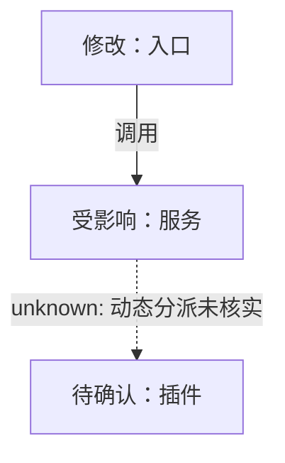
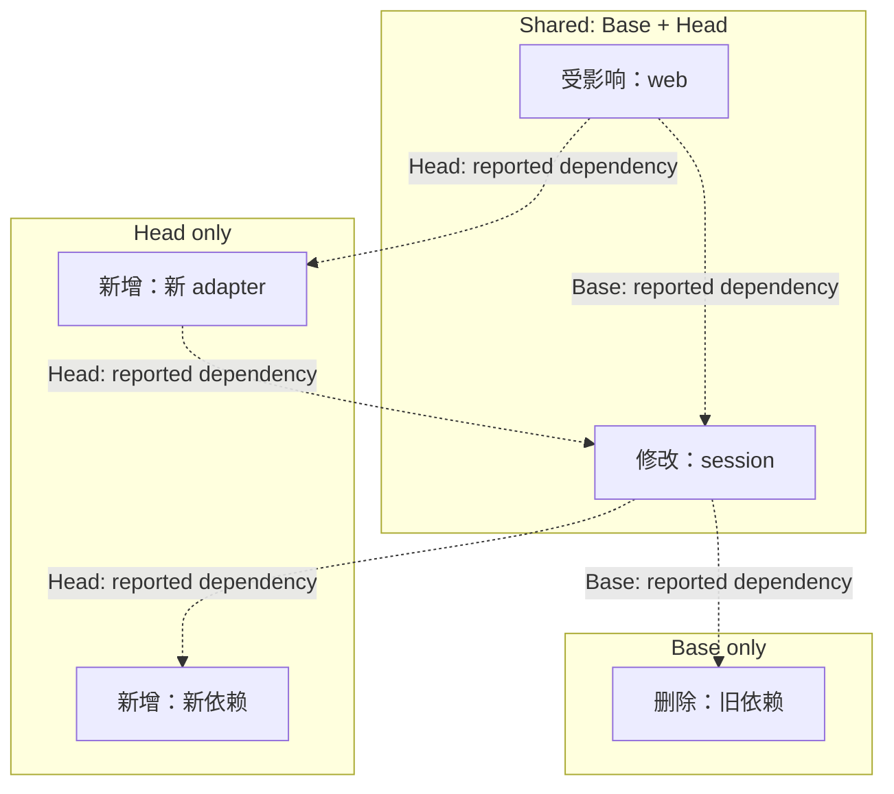
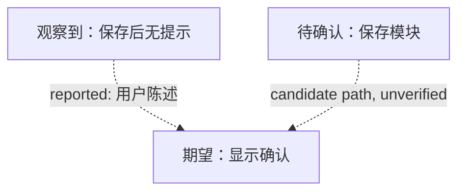

# Mermaid 影响图

PR 和 Issue 的影响图都用 Markdown 内嵌 Mermaid。GitHub 可在 PR、Issue、讨论和 Markdown 中渲染 Mermaid 代码块；不要再将影响图渲染成 SVG 附件。普通 PR/Issue 流程不另写 HTML 报告；明确的 PR 代码审查、架构审查和其他报告型任务按 `references/postplan-reports.md` 选择 Postplan。

示例：



先从 diff、源码、配置、测试和运行证据建立图，再检查目标平台的实际渲染。Mermaid 只表达已核实的关系和影响范围；它不能替代源码审查或测试，也不自动证明图的完整性。

## 共同要求

- 默认使用 `flowchart TB`。只有节点很少且不会造成横向溢出时才用 `LR`。
- 使用短标签和子图分组，只保留理解影响所需的节点，通常控制在 5–12 个；图较小时不补无关节点。将同一职责的多个文件聚合为一个可识别模块；模块仍过多时拆成两张小图，并在正文列出覆盖范围。不能为了缩小图而漏掉跨边界影响。
- 每个节点直接写状态文字：`新增`、`修改`、`删除`、`受影响`、`未改`、`观察到`、`期望` 或 `待确认`。颜色只作辅助，不能单独表达状态。
- 边用有向箭头并写明关系，例如 `调用`、`依赖`、`发送事件`。箭头表示从起点指向终点，具体含义由边标签确定。仅由源码、配置或实际运行确认的边使用实线；报告者提供的关系标 `reported`，静态推断标 `inferred`，未知关系标 `unknown`，这些边使用虚线并在标签中写清依据或不确定性。
- Mermaid 边标签统一使用管道形式，例如 `A -.->|reported: 用户陈述| B`；不要给内联边标签加引号，避免部分渲染器把引号显示为标签内容。
- 标出变更模块的直接与间接受影响消费者，并在图或图外写明影响起点、Base/Head 版本和跳数。对 `A depends on B` 这样的边，从改动的 `B` 沿反方向追踪消费者 `A`；只有路径有证据支持时才计算跳数。报告者提供的路径只能说明报告范围内的影响，并须标为 reported/inferred；不要改从附近的新依赖起算，也不要把所有相连模块都自动标为受影响。多个模块改动时，分开写各自的影响范围。
- 在图外写明 Base SHA、Head SHA、Coverage 和主要 unknowns。记录证据来源（文件/符号、配置、测试、运行日志或报告者陈述）；SHA 和证据不要塞进节点标签。
- 图的节点、边和状态必须能回溯到实际 diff 与证据。用户或 Issue 提供的关系可以展示，但要标为 `reported`；缺少证据的关系不得标为 confirmed。未覆盖的反射、插件发现、配置路由、动态分派和运行时数据流要列在 Coverage/unknowns 中。
- 交付前在目标平台预览 Mermaid。确认所有图块都渲染、节点和边没有被裁切或重叠、标签能读、图例含义明确。语法块本身存在不等于渲染验收通过；没有可用预览时明确标为未验证。

## PR Change map

- 从目标分支 merge-base 和当前 head 取证并记录 SHA。已有 CodeGraph 索引且工具可用时用它导航；不要为画图初始化索引或安装工具，除非用户分别授权。索引只覆盖一个版本时，另一版本须从对应源码、配置或测试补证。
- 展示 Head 的主要模块路径与本次变化。节点只出现一次；节点标签写状态。Base 中存在、Head 中删除的节点可留在图中并标为 `删除`；删除关系用虚线标 `Base only / removed`。新增或变化的边按实际证据标识，不把旧边与新边合并成虚假环。
- Base 与 Head 拓扑不同时，按 `Shared`、`Base only` 和 `Head only` 子图组织节点。只在 `Shared` 中放置两个版本都存在的模块；不能再把同一模块复制进 `Base only` 或 `Head only`。即使共享模块状态是 `修改`，也只出现一次。`Base only` / `Head only` 表示版本归属，不替代节点的新增/删除状态。边标签写明 `Base`、`Head` 或两者，避免复制两套快照或把旧边与新边连成环。模块很多时可按子系统分组，但仍须清楚表达版本归属。保持边标签简短，长说明写在图外。
- 图外说明影响距离或分层口径（例如“直接受影响”“经两层调用受影响”）。文档专属改动也画 Mermaid 图，并写明“源代码依赖图未变化”。局部图不得称为完整调用图。

建议的 PR 正文骨架。分组和影响层级示例按报告者提供的路径绘制，不代表已由源码核实：

````markdown
### Change map
Base: `<base SHA>` · Head: `<head SHA>` · Coverage: <证据范围与限制>



Impact from modified session: Base 中 web 是直接消费者（1 hop）；Head 中新 adapter 是直接消费者（1 hop），web 是间接受影响消费者（2 hops）。影响层级根据报告路径推断，尚未由源码核实。

Unknowns: <未覆盖的关系或行为>
````

PR 正文仍需写 Why、改动范围、风险、真实验证结果和回滚方式。Mermaid 图内嵌在正文中，不生成图片附件；用户只要草稿时交付 Markdown 正文。

## Issue map

- Bug 图分清报告者动作、观察到的结果和待确认的期望。Feature 图分清当前路径与目标路径。
- 证据不足时只画已知步骤和“等待补充”节点。候选模块明确标 `待确认`，关系用虚线；不要猜测调用链。
- 图外列出复现状态、来源、证据限制和需要补充的信息。只在需要验证并发、协议或跨状态不变量时使用 pstack `statechart` / TLA+ / TLC；普通 Issue 不做形式化建模。

Issue 正文可使用内嵌 Mermaid 代码块，并同时写清问题/目标、实际与期望行为、验收条件和未知项。Issue 图不需要 PR 专用的 Base/Head SHA；图外记录报告者陈述、复现状态与证据限制。没有创建/更新授权时只交付本地 Markdown 草稿；不上传图附件或执行 tracker 写入。

Issue 示例：



## 自查

- 图中模块与变化是否对应实际 diff？是否遗漏直接受影响的消费者？
- 每条实线关系是否有源码、配置、测试或运行证据？不确定关系是否用虚线并标明依据？
- Base/Head SHA、图外 Coverage、影响层级和 unknowns 是否准确？
- Issue 的观察与期望是否分开？报告者线索是否明确标为 `reported`？
- 目标平台预览是否无语法错误、裁切、重叠和难读标签？未能预览时是否明确说明？

图用于快速理解审查范围，不能替代复现、测试或代码审查。关键行为仍须用真实运行、测试或受控复现核验。

## Postplan 报告

触发场景、确认步骤、敏感内容处理和 PR / Issue 链接权限见 `references/postplan-reports.md`。报告复用已经核实的图数据和证据；不要为了生成页面重做分析。
