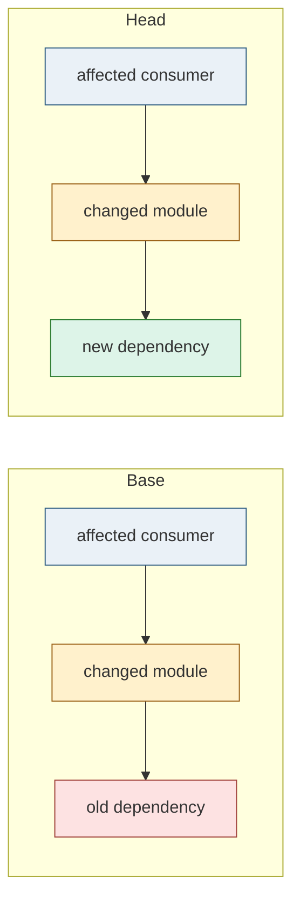
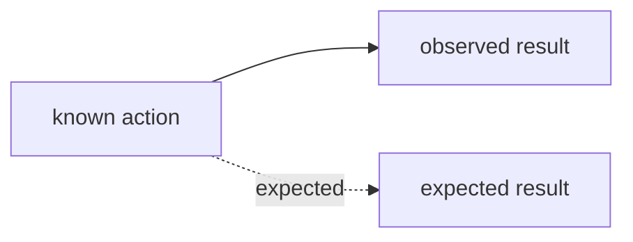

# Issue / PR 影响图与 Postplan 报告

Issue 和 PR 的描述应让人先看见问题或改动，再按链接展开证据。描述内放一张 Mermaid 图和简短结论；Postplan 页面承载完整 HTML 报告。

## Issue 图

- 用状态图或流程图表达报告者动作、可复现的实际结果、期望结果和已确认的代码路径。
- 证据不足时把未知写成未知。可以画出“信息缺失 → 等待补充”的 triage 路径，不推测运行时路径。
- 功能提案用当前行为与目标行为两条路径，并把尚未决定的行为留在问题列表。
- 只有需要验证并发、协议或跨状态不变量时才建 TLA+/TLC 模型。普通 Issue 不要求形式化建模。

## PR 依赖图

- 对比目标分支的 merge-base 和当前 head，记录两个 SHA。优先使用仓库已有的代码索引或依赖工具；仓库有 `.codegraph/` 时先用 CodeGraph。
- 依赖拓扑有变化时并排画 base/head；拓扑没变时可以画一张状态图，并明确写“依赖拓扑未变化”。
- 节点以包、模块或清晰的子系统为主。只在定位不清时展开到文件或符号。
- 颜色固定：绿色新增，橙色修改，红色删除，灰色未改但直接受影响。
- 箭头 `A --> B` 固定表示“A 依赖 B”。图例说明依赖来自 import、调用、配置还是人工推断。
- 展示改动节点、依赖边的增删，以及直接受影响的未改节点。复杂图先聚合到模块层；不要为了塞进一张图而省略跨边界的影响。
- 文档专属改动仍给出简图，并写明“源代码依赖图未变化”。
- 标注分析覆盖范围和静态分析看不到的关系，如反射、插件发现、配置路由或运行时数据流。不能把局部图称作完整调用图。

## 描述与完整报告

PR 描述使用 `Change map` 小节，包含 base/head、分析范围、Mermaid 图、影响结论、验证证据和完整报告链接。Issue 描述使用 `Issue map` 或 `Reproduction map`，包含实际/期望状态、未知项和完整报告链接。

只准备本地草稿时，生成的 HTML 可留在本地；描述中的报告地址保留为醒目的代码占位符 `POSTPLAN_URL_PENDING_APPROVAL`，并注明 Postplan 发布待本次授权。不要把本机文件路径当作报告链接。创建或更新远端描述前，先完成报告发布授权并换成实际 URL。未获授权时不编造 URL，也不提交带占位地址的远端描述。

交付 Issue / PR 正文时直接给可粘贴的 Markdown。正文含 Mermaid 代码块时，不要再用三反引号包住整篇正文；若需要外围示例代码块，使用四个反引号。

````markdown
## Why
<reason>

## What changed
<scope>

## Non-goals
<out of scope>

## Blast radius
<affected modules and boundary changes>

## Change map
Base: `<base SHA>` · Head: `<head SHA>` · Coverage: `<tool and limits>`



**Impact:** <why the changed boundary matches the request>
**Verification:** <command and observed result>
**Merge danger:** <reversible or one-way action and why>
**Full report:** `POSTPLAN_URL_PENDING_APPROVAL`
````

Issue 描述可以用以下骨架；复现信息未知时保留 `Unknowns`，不编造代码路径：

````markdown
## Problem / goal
<one sentence>

## Current and expected behavior
<observed behavior and desired behavior>

## Acceptance criteria
- [ ] <observable result>

## Issue map


**Unknowns:** <questions or none>
**Full report:** `POSTPLAN_URL_PENDING_APPROVAL`
````

完整报告记录需求或 Issue 编号、base/head SHA、图的来源、节点与边、影响解释、验证证据和未覆盖关系。页面更新时使用同一份本地 HTML 更新同一个 Postplan draft，保留稳定 URL，并检查报告中的 head SHA 已刷新。

每个 Issue / PR 使用各自的 Postplan draft，不跨事项共用链接。后续更新同一事项时更新对应报告并保留其 URL。

## Agent 自查

在交付描述前逐项核对：

- 图中的改动节点是否与实际 diff 一致，有没有遗漏新增、删除或移动的模块？
- 新增/删除的依赖边和受影响调用方是否符合源码证据？
- 跨模块改动是否有明确的理由和验证？
- Issue 的实际路径与预期路径是否来自报告者信息或真实复现？
- 图无法覆盖的动态关系是否明确列出，结论是否超出证据？

图用于定位审查范围，不能替代复现、测试或代码审查。关键安全假设至少用一次真实运行、测试或受控复现核实。

## Postplan 发布边界

- 需要生成完整 HTML 报告时加载 `html-stable-publish`，遵循它的 preflight、公开发布确认和 URL 核验步骤。
- Postplan URL 是公开页面。每次上传前取得本次明确确认；清理私有文件名、代码片段、Issue 原文、分支名、凭据和内网链接。
- 私有仓库或不适合公开的内容只保留描述内的 Mermaid 图，或使用用户指定的私有报告位置。不得把公开 Postplan 链接当作私有链接。
- 没有上传确认时，不伪造 Postplan URL。说明报告已准备好、等待发布确认，再决定是否创建含该链接的外部描述。
