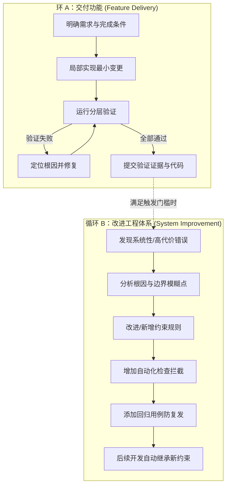

# 代码库治理规范 (Codebase Governance)

> 本规范是 lora-mode 项目初始化、接手既有系统与长期架构治理的核心标准。
> 建立在「正确性定义、架构职责、三类规则、分层验证、双循环演进、文档体系」六大支柱之上。

---

## 一、目标与正确性定义 (Target & Correctness)

在编写或修改任何代码前，必须先明确定义系统的核心事实与不可违反的不变量：

| 维度 | 定义要求 | 示例（任务执行系统） |
|---|---|---|
| **核心对象** | 明确业务概念及其唯一属主 | 用户、任务、执行记录、交付工件 |
| **主要行为** | 对象支持的确定性动作 | 创建任务、调度执行、取消任务、查询结果 |
| **状态变化** | 严格有限状态机，禁止非法跳跃 | 待执行 → 运行中 → 已完成 / 失败 / 已取消 |
| **数据归属** | 实体所属的租户与主体边界 | 每条任务必须归属于一个具体用户，跨用户强隔离 |
| **系统不变量** | 系统中任何时刻都不可违背的事实 | 已取消的任务不得继续提交执行结果；已归档数据不可变 |
| **完成条件** | 行为结束时可独立检验的客观状态 | 创建、执行、取消和查询均产生可验证的数据和日志 |

**不可违反的系统事实 (Non-negotiable Truths)**：
每个项目必须在 `AGENTS.md` 顶层明确写出 3–5 条不可违反的事实（如「生产数据严禁本地连接」、「取消信号必须具备幂等消费能力」）。违反代价高且无法从局部代码推导的事实，是整个系统的治理底线。

---

## 二、架构系统与职责边界 (Architecture System)

架构的核心是划分职责、限定通信路径，并提供统一的底层支撑：

1. **职责所有权 (Ownership)**：每个业务概念有且仅有一个所有者模块。禁止多个模块交叉维护同一份状态。
2. **公开契约 (Public Contracts)**：模块间协作只能通过显式导出的公开接口（API / SDK / 契约定义）；禁止绕过公共接口私自 import 或篡改其他模块的内部私有实现。
3. **依赖规则与防循环 (Dependency Rules)**：
   - 规定单向依赖层级（如：Controller → Service → Repository，禁止逆向引用）。
   - 禁止任何模块间的循环依赖（A 依赖 B 且 B 依赖 A）。
   - 必须配置静态依赖检查工具（如 `dependency-cruiser`、lint 规则或架构测试）进行自动化拦截。
4. **局部化修改 (Locality of Change)**：业务需求变动时，改动范围必须尽量局限在所属模块内部，不得引发无关模块的联动修改或涟漪效应。
5. **底层公共底座 (Common Capabilities)**：日志记录、配置加载、通用数据结构、统一错误模型下沉为底层公共模块；业务模块单向引用公共底座，公共底座不得向上依赖任何具体业务。

---

## 三、三类规则系统与执行机制 (Three-Tier Rule System)

规则必须有明确的执行机制，说明违反后果与发现机制。禁止将所有规则混在一个巨大的规则文件中：

| 规则类别 | 约束内容 | 执行机制 | 违反后果 | 示例 |
|---|---|---|---|---|
| **硬规则 (Hard Rules)** | 权限、模块边界、接口类型、依赖方向 | 编译期检查、静态分析工具、CI 门禁、权限单元测试 | 编译失败或构建被拒 | 禁止绕过模块公开接口直接引用私有文件；数据操作必须校验租户权限 |
| **过程规则 (Process Rules)** | 工作流纪律、先验后推、提交规范、证据核验 | CI 流水线、预提交脚本、提交证据比对、自动化技能 | PR 阻塞或提交被拒 | 先验证通过再提交代码；PR 必须附带最新 head 的可验证证据 |
| **判断规则 (Judgement Rules)** | 产品体验、复杂架构权衡、非功能权衡 | 架构决策记录 (ADR) 审查、同行/Agent 隔离评审 | 需评审讨论或驳回方案 | 重大架构改造必须说明取舍原因；高并发链路选择最终一致性而非强一致性 |

**规则有效性准则**：
- 每一条规则创建时必须指定发现机制与违规处置手段。
- 无法自动检查的规则尽量转为带确定性检查点的过程规则；无法程序化的深层取舍归入判断规则并通过 ADR 记录。

---

## 四、分层验证系统 (Hierarchical Verification Matrix)

在实现功能前，先明确什么证据能够证明功能正确。按 7 级验证矩阵逐层检验：

| 检查层级 | 验证核心内容 | 典型验证方式 |
|---|---|---|
| **1. 数据层 (Data)** | 实体记录合法、字段完整、格式合规 | Schema 校验、数据库约束测试、序列化往返测试 |
| **2. 业务层 (Business)** | 状态流转符合状态机规则，业务计算准确 | 核心业务单元测试、状态转换驱动测试 |
| **3. 权限层 (Permissions)** | 越权访问被拒，非属主无法操作 | 权限矩阵测试、反向攻击边界测试 |
| **4. 集成层 (Integration)** | 模块间接口协作通畅，事件正确分发 | 模块集成测试、契约测试、Mock 联调 |
| **5. 用户操作层 (User Flow)** | 用户主流程能看到正确产物与界面反馈 | E2E 测试、真实命令运行输出、UI 截图/录屏 |
| **6. 异常层 (Exceptions)** | 输入错误、依赖崩溃、网络超时均有确定处理 | 异常注入测试、边界值探针、降级容错验证 |
| **7. 回归层 (Regression)** | 既有功能与全局不变量未受破坏 | 全量/定向回归测试套件、不变量断言 |

**重复测试流程工具化**：
凡是需要重复手动执行的验证链路（如多次点击、手写 curl、复杂数据 mock），必须固化为测试脚本、CLI 命令或独立技能，禁止靠记忆或口头复述验证。

---

## 五、双循环反馈与演进系统 (Dual-Loop Evolution Model)

项目必须维持功能交付与工程进化的平衡，通过双循环保持可靠演进：

### 1. 环 A：交付功能 (Feature Delivery)
- **核心流程**：明确需求 → 局部实现 → 运行验证 → 验证失败则修复 → 提交证据。
- **度量指标**：任务完成率、验证通过率、人工返工次数。
- **定位**：负责产品业务进展，保持交付敏捷，不随意扩张非必要的架构改动。

### 2. 循环 B：改进工程体系 (System Improvement)
- **核心流程**：发现错误 → 确认根因/边界 → 改进约束规则 → 增加自动检查 → 添加回归用例 → 后续开发自动继承约束。
- **度量指标**：重复错误率、规则有效性、系统复杂度。
- **触发时机与门槛（严格把关）**：
  - **必须在环 A 交付完成后执行**，不打断业务交付。
  - **严禁为每个偶发小错增加永久规则**。只有当错误代表**通用系统性风险**（如循环依赖、跨层旁路、不变量失效）、**代价足够高**，或**同类问题复现/积累到阈值**时，才进入循环 B 固化。
  - 避免仅有环 A 导致技术债堆积，也要避免滥用循环 B 陷入无休止的过度设计与规范重构。

---

## 六、代码库文档与组织体系 (Documentation Layout)

治理良好的项目采用清晰的分层文档结构，职责明确：

| 文件 / 目录 | 职责与记录内容 | 不写什么 |
|---|---|---|
| `README.md` | 项目目标、核心价值、用户画像、做什么与**不做什么 (Non-goals)** | 不写内部具体实现细节与过长配置清单 |
| `docs/architecture/` | 系统分工、数据流、模块协作契约、底层公共能力 | 不复制源码已自解释的字段清单 |
| `rules/` | 必须遵守的工程约束，分为 hard / process / judgement 独立子文件 | 不堆砌无执行机制的口头建议 |
| `verify/` | 如何证明任务完成、各层级测试命令、自动化校验脚本 | 不写未经验证的理想化假设 |
| `decisions/` (ADR) | 重大架构设计的背景、理由、所选方案、放弃的替代方案及权衡 | 不写日常琐碎 Bug 修复记录 |
| `AGENTS.md` | Agent 全局入口：系统不变量、先读什么、基础命令、文档索引指针 | 不保存整个项目的完整知识树（保持 ≤150 行） |
